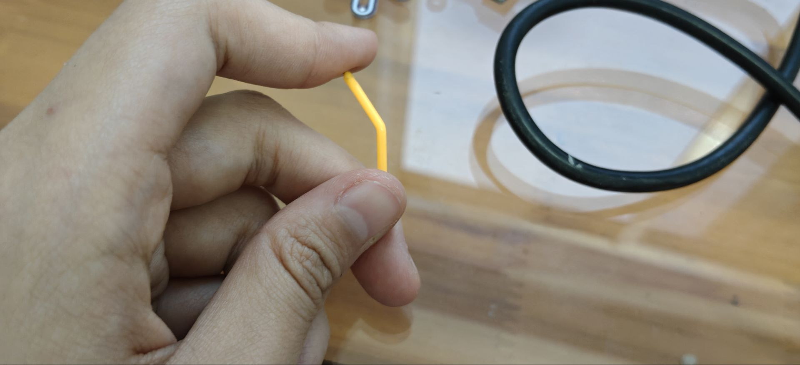

#Snowflake-Light
*第一次焊接，设备都是借的，实在痛苦，没有加热台，没有热风枪。
忘记跟社长说，我焊接的是贴片元件。
这个加热台焊接陶瓷灯实在痛苦。买了10个，焊接断了5个，搞了n+个小时。
这该die的心血来潮*

还有这个typeC，对我真不见外。

最后也是圆满的获得了成功之母

不过学长这场地太Hang了，单间，超大桌，靠窗，还有排风，冷风口，24在线。
这个社团开学到现在，最有用一集
